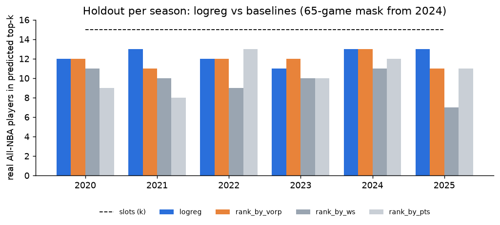
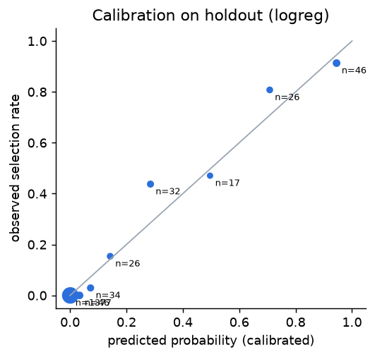

# All-NBA / award prediction: results

Real data: Kaggle `sumitrodatta/nba-aba-baa-stats` (Basketball-Reference export).

```
downloaded: 2026-11-12T03:24:11
source: local zip kaggle_bref.zip (downloaded with curl from https://www.kaggle.com/api/v1/datasets/download/sumitrodatta/nba-aba-baa-stats on 2026-11-12, HTTP 200, 11.3 MB)
file modification dates inside the zip: 2026-11-01
max season per file (season = ENDING year):
  Advanced.csv: 2027
  Player Per Game.csv: 2027
  Team Summaries.csv: 2027
  End of Season Teams.csv: 2025
  End of Season Teams (Voting).csv: 2025
  Player Award Shares.csv: 2025
  All-Star Selections.csv: 2026
```

- Train: 1980-2019. Holdout: 2020-2025 (the labelled seasons after training).
- Tuning: forward-chaining CV inside the training range, with blocks 2000-2004, 2005-2009, 2010-2014, 2015-2019. Each block is scored by a model trained only on earlier seasons.
- Model and hyperparameter selection is by mean CV PR-AUC. The holdout was not used for those choices. Chosen: **logreg** `{"C": 0.1}`. Platt calibration (fitted on the out-of-fold CV predictions) was added *after* the first holdout run showed the class-balanced probabilities were inflated. It is monotone, so the ranking metrics (PR-AUC, ROC-AUC, precision@k) are unaffected, but the holdout Brier score and reliability table come after that inspection. The CV evidence supports the change on its own: the uncalibrated CV Brier of the chosen configuration was 0.0435, versus random_forest 0.0166, hist_gb 0.0168.
- **precision@k**: per season, the share of the real All-NBA players found in the model's top-k. k = 10 for 1980-88 and 15 from 1989.

## Headline

- On the holdout with the 65-game mask, logreg recovers **74/90** real All-NBA players. **Rank by VORP** recovers **71/90**. PR-AUC is 0.915 vs 0.883.
- CV: precision@k 0.797 vs 0.693 for VORP; PR-AUC 0.899 vs 0.765.
- **Verdict:** In CV (20 seasons, 2000-2019) the chosen model clearly beats rank-by-VORP (precision@k +0.103); it beats it only narrowly on the holdout (+3 players; per season 2 wins, 1 losses, 3 ties), within season-to-season noise. CV PR-AUC of the three model families spans 0.896-0.899 (indistinguishable).
- Sample size: 6 holdout seasons (2020-2025), 90 slots; 2 of them (30 slots) are in the positionless / 65-game era. Numbers for that era are very noisy.

## Cross-validation (training range only)

| scorer                  |   cv_pr_auc |   cv_precision_at_k | params                                                                                                         |
|:------------------------|------------:|--------------------:|:---------------------------------------------------------------------------------------------------------------|
| logreg                  |       0.899 |               0.797 | {"C": 0.1}                                                                                                     |
| random_forest           |       0.897 |               0.783 | {"max_depth": 8, "min_samples_leaf": 1}                                                                        |
| hist_gb                 |       0.896 |               0.810 | {"learning_rate": 0.1, "max_iter": 150, "max_leaf_nodes": 8, "min_samples_leaf": 20, "l2_regularization": 1.0} |
| rank_by_vorp            |       0.765 |               0.693 |                                                                                                                |
| rank_by_ws              |       0.765 |               0.697 |                                                                                                                |
| rank_by_pts             |       0.667 |               0.633 |                                                                                                                |
| logreg_no_voter_history |       0.899 |               0.807 | ablation                                                                                                       |


## Holdout, 65-game rule applied from 2024 (approximation: total games >= 65)

| scorer                  |   pr_auc |   roc_auc |   brier |   precision_at_k |   hits |   slots |   p@k_2020_2023 |   p@k_2024plus |
|:------------------------|---------:|----------:|--------:|-----------------:|-------:|--------:|----------------:|---------------:|
| logreg                  |    0.915 |     0.995 |   0.014 |            0.822 |     74 |      90 |           0.800 |          0.867 |
| random_forest           |    0.921 |     0.994 |   0.014 |            0.844 |     76 |      90 |           0.817 |          0.900 |
| hist_gb                 |    0.905 |     0.993 |   0.015 |            0.833 |     75 |      90 |           0.800 |          0.900 |
| logreg_no_voter_history |    0.927 |     0.996 |   0.013 |            0.844 |     76 |      90 |           0.833 |          0.867 |
| rank_by_vorp            |    0.883 |     0.989 | nan     |            0.789 |     71 |      90 |           0.783 |          0.800 |
| rank_by_ws              |    0.716 |     0.970 | nan     |            0.644 |     58 |      90 |           0.667 |          0.600 |
| rank_by_pts             |    0.748 |     0.970 | nan     |            0.700 |     63 |      90 |           0.667 |          0.767 |


Without the mask (raw model output):

| scorer                  |   pr_auc |   precision_at_k |   hits |
|:------------------------|---------:|-----------------:|-------:|
| logreg                  |    0.899 |            0.789 |     71 |
| random_forest           |    0.907 |            0.811 |     73 |
| hist_gb                 |    0.893 |            0.800 |     72 |
| logreg_no_voter_history |    0.915 |            0.822 |     74 |
| rank_by_vorp            |    0.874 |            0.778 |     70 |
| rank_by_ws              |    0.709 |            0.633 |     57 |
| rank_by_pts             |    0.717 |            0.644 |     58 |


Masking ineligible players changes hits by logreg +3, random_forest +3, hist_gb +3, logreg_no_voter_history +2, rank_by_vorp +1, rank_by_ws +1, rank_by_pts +5. All of the change is in 2024-2025, the only seasons the rule applies to.

### Per-season hits (masked)

|   season |   hist_gb |   logreg |   logreg_no_voter_history |   random_forest |   rank_by_pts |   rank_by_vorp |   rank_by_ws |
|---------:|----------:|---------:|--------------------------:|----------------:|--------------:|---------------:|-------------:|
|     2020 |        12 |       12 |                        12 |              11 |             9 |             12 |           11 |
|     2021 |        12 |       13 |                        13 |              13 |             8 |             11 |           10 |
|     2022 |        13 |       12 |                        13 |              13 |            13 |             12 |            9 |
|     2023 |        11 |       11 |                        12 |              12 |            10 |             12 |           10 |
|     2024 |        14 |       13 |                        13 |              15 |            12 |             13 |           11 |
|     2025 |        13 |       13 |                        13 |              12 |            11 |             11 |            7 |




### Position-constrained picks for pre-2024 seasons (2 G / 2 F / 1 C per team)

B-Ref `pos` is mapped to G/F/C (PG/SG to G, SF/PF to F, C to C). This is not the ballot position voters used.

| scorer                  |   p@k_2020_2023_positional |   p@k_2020_2023 |
|:------------------------|---------------------------:|----------------:|
| logreg                  |                      0.817 |           0.800 |
| random_forest           |                      0.783 |           0.817 |
| hist_gb                 |                      0.750 |           0.800 |
| logreg_no_voter_history |                      0.833 |           0.833 |
| rank_by_vorp            |                      0.800 |           0.783 |
| rank_by_ws              |                      0.717 |           0.667 |
| rank_by_pts             |                      0.717 |           0.667 |


Result (2020-2023): **mixed, no reliable gain** (better for 4, worse for 2, equal for 1 scorers). Not used by default.

### Voter-history ablation

Removing prior All-NBA, previous-season All-NBA, prior All-Star and prior MVP top-5 features: CV PR-AUC 0.899 vs 0.899 with them. Holdout hits 76 vs 74. **The voter-history features did not help measurably** (removing them: CV PR-AUC -0.000, holdout hits +2). The features stay in the main model, and this result is reported either way.

### Calibration (chosen model, holdout)

Before calibration the class-balanced logistic model's holdout Brier was 0.0415. After Platt calibration it is 0.0142. Sum of probabilities per season (target about 15): {'2020': 13.52, '2021': 16.39, '2022': 14.89, '2023': 14.47, '2024': 14.19, '2025': 14.87}.

| bin          |    n |   mean_pred |   observed |
|:-------------|-----:|------------:|-----------:|
| [0.0, 0.02)  | 1377 |       0.001 |      0.000 |
| [0.02, 0.05) |   46 |       0.034 |      0.000 |
| [0.05, 0.1)  |   34 |       0.073 |      0.029 |
| [0.1, 0.2)   |   26 |       0.142 |      0.154 |
| [0.2, 0.4)   |   32 |       0.285 |      0.438 |
| [0.4, 0.6)   |   17 |       0.497 |      0.471 |
| [0.6, 0.8)   |   26 |       0.708 |      0.808 |
| [0.8, 1.0)   |   46 |       0.945 |      0.913 |




Team assignment (ranks 1-5 = 1st team, ...) among correctly picked players: 61% on the right team.

### Errors on the holdout

Missed (real selections ranked outside the top 15):

|   season | player            |   g |   vorp |   rank_best_masked |   all_nba_team |
|---------:|:------------------|----:|-------:|-------------------:|---------------:|
|     2020 | Chris Paul        |  70 |  3.500 |             18.000 |          2.000 |
|     2020 | Pascal Siakam     |  60 |  2.000 |             21.000 |          2.000 |
|     2020 | Ben Simmons       |  57 |  2.800 |             25.000 |          3.000 |
|     2021 | Bradley Beal      |  60 |  2.900 |             18.000 |          3.000 |
|     2021 | Paul George       |  54 |  2.900 |             21.000 |          3.000 |
|     2022 | DeMar DeRozan     |  76 |  3.100 |             16.000 |          2.000 |
|     2022 | Ja Morant         |  57 |  3.900 |             17.000 |          2.000 |
|     2022 | Pascal Siakam     |  68 |  3.600 |             18.000 |          3.000 |
|     2023 | Jimmy Butler      |  64 |  5.800 |             16.000 |          2.000 |
|     2023 | Julius Randle     |  77 |  3.900 |             19.000 |          3.000 |
|     2023 | Jaylen Brown      |  67 |  2.000 |             23.000 |          2.000 |
|     2023 | De'Aaron Fox      |  73 |  2.700 |             24.000 |          3.000 |
|     2024 | Stephen Curry     |  74 |  4.400 |             16.000 |          3.000 |
|     2024 | Tyrese Haliburton |  69 |  5.000 |             18.000 |          3.000 |
|     2025 | Jalen Williams    |  69 |  3.400 |             16.000 |          3.000 |
|     2025 | Donovan Mitchell  |  71 |  3.200 |             17.000 |          1.000 |


False positives (picked, not selected):

|   season | player            |   g |   vorp |   rank_best_masked |   all_nba_share |
|---------:|:------------------|----:|-------:|-------------------:|----------------:|
|     2020 | Joel Embiid       |  51 |  2.500 |             11.000 |           0.158 |
|     2020 | Kyle Lowry        |  58 |  2.800 |             12.000 |           0.052 |
|     2020 | Domantas Sabonis  |  62 |  2.900 |             13.000 |           0.000 |
|     2021 | James Harden      |  44 |  3.700 |              5.000 |           0.082 |
|     2021 | Russell Westbrook |  65 |  3.400 |             12.000 |           0.088 |
|     2022 | Rudy Gobert       |  66 |  3.600 |              9.000 |           0.090 |
|     2022 | James Harden      |  65 |  3.700 |             11.000 |           0.000 |
|     2022 | Jimmy Butler      |  57 |  4.000 |             14.000 |           0.064 |
|     2023 | Kevin Durant      |  47 |  3.900 |              6.000 |           0.070 |
|     2023 | James Harden      |  58 |  4.000 |             11.000 |           0.012 |
|     2023 | Anthony Davis     |  56 |  4.000 |             12.000 |           0.130 |
|     2023 | Ja Morant         |  61 |  3.800 |             14.000 |           0.088 |
|     2024 | Damian Lillard    |  73 |  2.700 |             12.000 |           0.000 |
|     2024 | Rudy Gobert       |  76 |  2.500 |             14.000 |           0.024 |
|     2025 | Domantas Sabonis  |  70 |  4.400 |             10.000 |           0.008 |
|     2025 | Ivica Zubac       |  80 |  3.400 |             13.000 |           0.030 |


Pattern: False positives played a median of 62 games vs 68 for correct picks (fewest: James Harden 2021 (44 g), Kevin Durant 2023 (47 g), Joel Embiid 2020 (51 g)). This *suggests* recent voters penalise absences more than the 1980-2019 training data implies, but it has not been tested. Misses had a median VORP of 3.3 vs 4.9 for correct picks (lowest: Pascal Siakam 2020 (VORP 2.0), Jaylen Brown 2023 (VORP 2.0), De'Aaron Fox 2023 (VORP 2.7)). These are players whose case rests on things the box score and team record do not capture.

## Secondary tasks

### All-NBA vote share (HistGradientBoostingRegressor)

- MAE over all rows 0.017; over vote-getters 0.127.
- Within-season Spearman with the real share (vote-getters) 0.81.
- Used as a selector (top-k, masked): precision@k 0.822. Team assignment 61%.

### All-Star selection (holdout 2020-2026, chosen by CV: logreg)

k = the real number of selections per season, including injury replacements. All-Stars are chosen per conference and at mid-season, and the model sees full-season stats without conference, so this is a rough fit.

| scorer       |   pr_auc |   roc_auc |   precision_at_k |   hits |   slots |   brier |
|:-------------|---------:|----------:|-----------------:|-------:|--------:|--------:|
| logreg       |    0.876 |     0.985 |            0.796 |    148 |     186 |   0.029 |
| hist_gb      |    0.880 |     0.984 |            0.780 |    145 |     186 |   0.029 |
| rank_by_pts  |    0.786 |     0.961 |            0.710 |    132 |     186 | nan     |
| rank_by_vorp |    0.794 |     0.969 |            0.731 |    136 |     186 | nan     |


### MVP (vote-share regression, holdout 2020-2025)

| scorer               |   winner_hits |   seasons |   mean_top5_overlap |
|:---------------------|--------------:|----------:|--------------------:|
| hist_gb_reg (masked) |             4 |         6 |               3.833 |
| hist_gb_reg (raw)    |             4 |         6 |               3.833 |
| rank_by_vorp         |             3 |         6 |               3.333 |
| rank_by_ws           |             4 |         6 |               2.833 |
| rank_by_per          |             4 |         6 |               3.333 |
| rank_by_bpm          |             4 |         6 |               3.667 |


Per season (model, masked):

|   season | pred_winner             | real_winner             | hit   |   real_winner_pred_rank |   top5_overlap |
|---------:|:------------------------|:------------------------|:------|------------------------:|---------------:|
|     2020 | Giannis Antetokounmpo   | Giannis Antetokounmpo   | True  |                       1 |              3 |
|     2021 | Nikola Jokić            | Nikola Jokić            | True  |                       1 |              4 |
|     2022 | Joel Embiid             | Nikola Jokić            | False |                       2 |              4 |
|     2023 | Nikola Jokić            | Joel Embiid             | False |                       2 |              4 |
|     2024 | Nikola Jokić            | Nikola Jokić            | True  |                       1 |              4 |
|     2025 | Shai Gilgeous-Alexander | Shai Gilgeous-Alexander | True  |                       1 |              4 |


With only 6 seasons, MVP winner accuracy cannot reliably separate the model from the simple metrics.

## Explainability

See [explain.md](explain.md) and `figures/shap_*.png`.

## Build log facts

- All-NBA selections removed by the population filter: 0; All-Star selections removed: 18.
- Feature NaNs in the qualified table: {'prev_all_nba': 264} (only the newest season's `prev_all_nba`, whose previous-season labels are unpublished; the gradient-boosting model handles NaN natively, the others impute the median).
- Label freshness (max season): {'all_nba': 2025, 'vote': 2025, 'mvp': 2025, 'all_star': 2026}.

